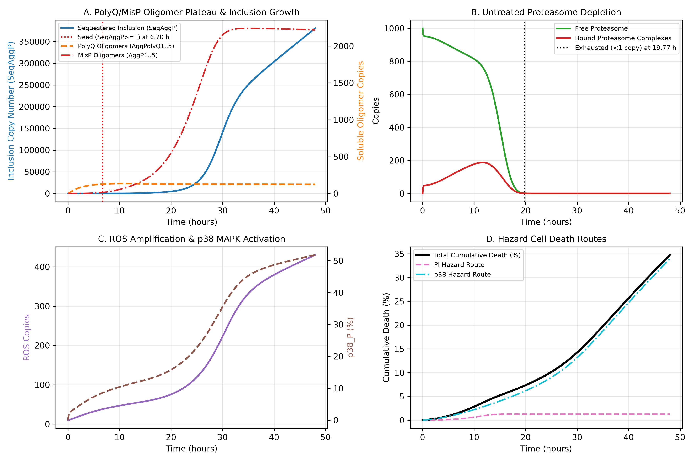
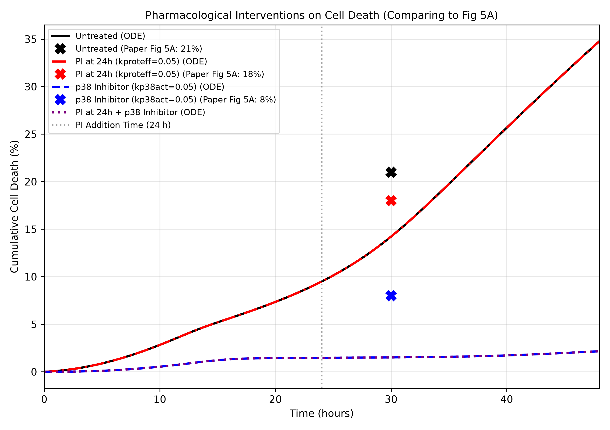
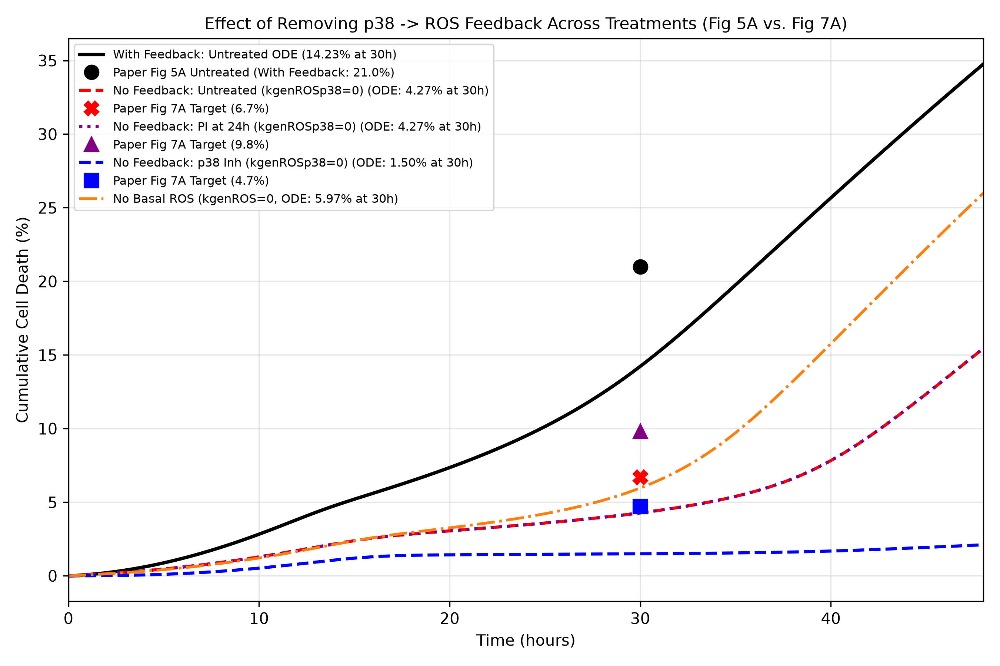
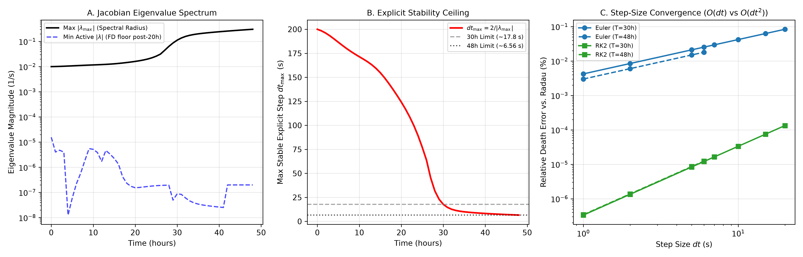
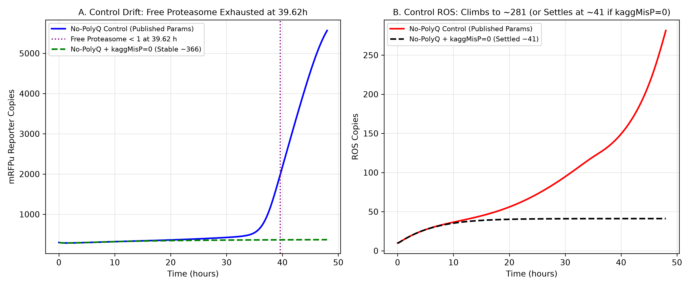
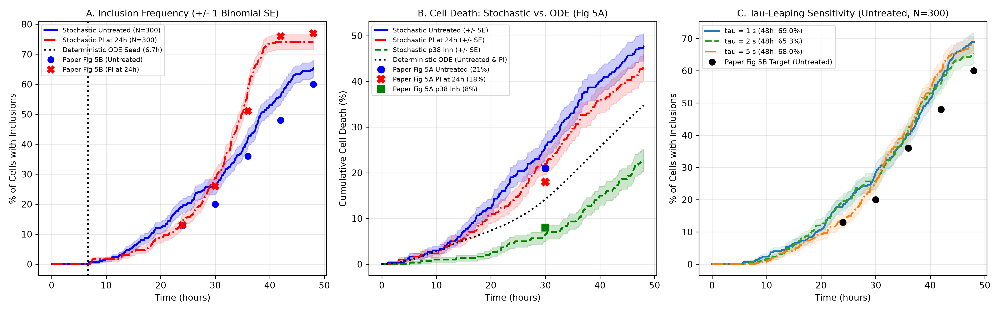

# tang_polyq: deterministic and stochastic re-implementation of Tang et al. 2010 (polyQ cytotoxicity)

SBE4140 modeling project, Cairo University. This repository re-implements the published model of Tang MY, Proctor CJ, Woulfe J, Gray DA, *Experimental and computational analysis of polyglutamine-mediated cytotoxicity*, PLoS Comput Biol 6(9):e1000944 (2010), in Python. The original model is stochastic (Gillespie-type). We built (i) a deterministic ODE version, solved with our own Euler and RK2 code and a stiff Radau reference, and (ii) a stochastic version of the same network (Poisson tau-leaping, N = 300 cells). The deterministic version does **not** reproduce the paper's population outputs. The stochastic version of the same network comes close to them, with two exceptions (untreated and PI death at 30 h run 4-5 points high, see Section 5.2). The deterministic failure is attributed to mean-field effects, not to a coding error.

There was no time to confirm and check all details anything that could not be confirmed from the repository, the proposal or the attached papers is marked **TO CONFIRM**.

**Contents**
1. [Concept, aims and hypotheses](#1-concept-aims-and-hypotheses)
2. [Repository layout](#2-repository-layout)
3. [Install and run](#3-install-and-run)
4. [Model verification](#4-model-verification)
5. [Results versus the paper](#5-results-versus-the-paper)
6. [Known caveats](#6-known-caveats)
7. [Next steps](#7-next-steps)
8. [References](#8-references)
9. [How to reproduce results](#9-how-to-reproduce-every-number)

---

## 1. Concept, aims and hypotheses

### 1.1 Concept

- **Model source:** BioModels BIOMD0000000285, revision 3, file `data/BIOMD0000000285_url.xml`, SHA-256 `3ac0c3fe2b5c886b90d9cebe76bfbc3c3ac957c302f36dda0e030a6ae9575997` (the model hash in the repo). The model is derived from Proctor et al. 2005. The paper's own ID for it is MODEL1002250000 (read project proposal).
- **Biology:** expanded polyglutamine huntingtin exon 1 (HttQ103) is toxic through a vicious cycle: polyQ aggregation, proteasome inhibition, ROS, p38 MAPK activation, more ROS, cell death. Inclusion bodies form late.
- **State variables:** copy numbers per cell (not concentrations). The time unit is seconds (Text S1, as quoted in the proposal, seriously just read it!).
- **Treatments** are parameter switches (proposal, from Text S1 Table S3):
  - Proteasome inhibitor (PI): at t = 24 h (86,400 s) `kproteff` drops from 1 to 0.05.
  - p38 blocker: `kp38act` = 0.05 from the start (SBML default value is 1).

### 1.2 Aims

| Proposal item | Proposal wording (shortened) | Status in this repo |
|---|---|---|
| Reproduce | Build the 27-species system from the SBML file in Python, solve it with our own Euler and RK2 code, compare against Tang's Figures 5 and 7 and against `solve_ivp`. | Done (Radau used as reference). |
| Analyse | Reduce to a core of five variables (native protein, misfolded protein, lumped clumps, free proteasome, ROS); find equilibria, Jacobian eigenvalues, nullclines, phase portraits. | Jacobian and eigenvalues done on the full model. The 5-variable reduction, equilibria, nullclines and phase portraits are **not done**. |
| Refine | Add one or two of: saturable proteasome clearance, an autophagy route, Torricella's nucleation step. | **Not done.** An inclusion-nucleation-hazard idea was tried and rejected (Section 7C). **TO CONFIRM** which refinements remain in scope. |
| Numerics | Study step size, error and stiffness for Euler against RK2. | Done (Section 5.4). |

The proposal also says its open items include agreeing how death is defined in the deterministic version (hazard idea) and how treatments run. Both are implemented (Section 2).

### 1.3 Hypotheses and verdicts

The hypotheses H1-H3 were formulated by the team after the proposal and do not appear in it.

| ID | Hypothesis | Verdict |
|---|---|---|
| H1 | A deterministic mean-field ODE of the published network reproduces the paper's population outputs (death at 30 h, inclusion frequency, mRFPu, drug effects). | **Not supported.** Untreated death at 30 h is 14.23 % (paper about 21 %), the PI at 24 h has no effect at all, the Fig 7A scenarios are far off, and the no-polyQ control drifts (Sections 5.1, 5.5). |
| H2 | The failure comes from mean-field effects (fractional-molecule self-amplification and loss of rare-event nucleation), not from a code error. | **Supported**, with the gaps listed in Section 5.2. The same network run stochastically (tau-leaping, N = 300) approximately reproduces the paper's inclusion curves and the p38 blocker effect. Untreated and PI death at 30 h are 4-5 points above the paper's read-off values. |
| H3 | Explicit Euler and RK2 are usable for this model within a step-size limit set by the Jacobian. | **Supported** (Section 5.4): Euler is first order, RK2 second order. dt = 7 s is stable at 30 h and unstable at 48 h. |

---

## 2. Repository layout

```
tang-polyq/
├── README.md
├── pyproject.toml                  package "tang_polyq", version 0.2.0
├── data/
│   └── BIOMD0000000285_url.xml     SBML model (BioModels, revision 3)
├── src/tang_polyq/
│   ├── model.py        SBML loader, rate and propensity compilation, stoichiometry matrix,
│   │                   switch use_mass_action_dimer
│   ├── scenarios.py    named experiments (parameter / initial-state overrides, 24 h switch)
│   ├── solvers.py      solve_euler, solve_rk2, solve_radau (rtol 1e-9, atol 1e-11),
│   │                   exact landing on the 24 h PI switch
│   ├── stochastic.py   vectorised Poisson tau-leaping ensemble
│   ├── analysis.py     survival, metrics, PAPER_TARGETS (digitised paper values)
│   ├── stability.py    Jacobian, eigenvalue evolution, step-size study
│   ├── plotting.py     figures fig1..fig6
│   ├── tables.py       CSV export
│   └── __main__.py     runs the whole pipeline
├── tests/
│   └── test_model.py   2 unittest tests (see Section 6, caveat 6)
└── outputs/
    ├── figures/        fig1_untreated_dynamics.png ... fig6_stochastic_comparison.png
    └── tables/         scenario_metrics_summary.csv, step_size_stability_study.csv,
                        stochastic_summary.csv
```

### Scenarios

| Name | Change versus the SBML defaults |
|---|---|
| `untreated` | none |
| `p38_inhibitor` | `kp38act` = 0.05 |
| `pi_24h` | `kproteff` = 0.05 from t = 24 h |
| `pi_24h_p38_inhibitor` | both of the above |
| `no_p38_ros_feedback` | `kgenROSp38` = 0 (Fig 7A, untreated) |
| `pi_24h_no_feedback` | `kgenROSp38` = 0, PI at 24 h (Fig 7A, PI) |
| `p38_inh_no_feedback` | `kgenROSp38` = 0, `kp38act` = 0.05 (Fig 7A, p38 blocker) |
| `no_basal_ros_gen` | `kgenROS` = 0 |
| `no_polyq_control` | PolyQ initial = 0 and `ksynPolyQ` = 0 |
| `no_polyq_no_agg` | as `no_polyq_control` and `kaggMisP` = 0 (SBML default 1e-11) |

### How the key quantities are defined

- **Deterministic death.** The two death species are treated as hazards. Survival is `S = exp(-(PIdeath + p38death))` and death is `1 - S` . This is the proposal's hazard idea, `dS/dt = -(kPIdeath * AggP_Proteasome + kp38death * p38_P) * S`.
- **Stochastic death.** A cell counts as dead when `PIdeath >= 1` or `p38death >= 1`. Dead cells' propensities are set to 0, so they stop reacting.
- **Inclusion.** A cell has an inclusion when `SeqAggP >= 1` (both deterministic seed time and stochastic frequency).
- **Free proteasome "exhausted"** means fewer than 1 free copy (label in Fig 1B).
- **Standard error** of the stochastic death and inclusion percentages is a binomial formula on 300 cells.
- **Stochastic species means** (`mean_y_alive`) average over surviving cells only; `mean_y_all` (dead cells frozen) also exists.

---

## 3. Install and run

Requirements (`pyproject.toml`): Python >= 3.9, numpy >= 1.22, scipy >= 1.9, matplotlib >= 3.6.
Checked in a scratch run for this README with Python 3.13.16, numpy 2.5.3, scipy 1.18.1, matplotlib 3.11.2.

```bash
cd tang-polyq
pip install -e .                       # or: use PYTHONPATH=src as below
python -m unittest discover -s tests   # 2 tests, about 1 s (with PYTHONPATH=src if not installed)
PYTHONPATH=src python -m tang_polyq    # full pipeline
```

- **Run from the repository root.** `tables.py` and `plotting.py` write to `outputs/tables` and `outputs/figures` relative to the current directory and **overwrite** existing files.
- The pipeline prints a model summary, deterministic scenarios, the stability study, the stochastic ensembles and a final "audit" with the numbers quoted below.
- Stochastic seeds are fixed in `__main__.py`: untreated at tau = 1, 2 and 5 s all use seed 42; PI at 24 h uses 101; p38 blocker uses 202. The untreated tau = 2 s run is both the main untreated result and the middle point of the tau sweep.
- **Run time of the full pipeline:** about 7 min 7 s wall-clock in a scratch run on a single cloud CPU (almost all of it in the stochastic ensembles). It will differ on your machine.

---

## 4. Model verification

| Check | Result | Where |
|---|---|---|
| Dynamic species | 25 (`Source` and `Sink` are boundary species, 27 in total, matching the "27 species" in the proposal) | `tests/test_model.py` |
| Reactions | 72 | `tests/test_model.py` |
| Kinetic parameters | 47 | `tests/test_model.py` |
| Stoichiometric rank | 24 of 25, i.e. one conservation law | `tests/test_model.py` |
| Conservation law | p38 + p38_P = 100, holds along the Radau trajectory (rtol 1e-7) | `tests/test_model.py` |
| Proteasome | **Not** conserved: the sequestration reactions consume it, so free proteasome can reach 0 | Fig 1B |
| Dimer edit (X-1) -> X | Replacing the SBML `X*(X-1)` by mass action `X^2` in the ODE (switch `use_mass_action_dimer`) changes untreated 48 h death by 0.00 points (34.76 vs 34.76) | printed by `__main__.py` |
| Radau regression values | 30 h death 14.23 %, 48 h death 34.76 %, seed 6.70 h, proteasome exhaustion 19.77 h | `tests/test_model.py` |

---

## 5. Results versus the paper

Paper values are **read by eye from the paper's figures** and carry an uncertainty of about +/-1-2 points. They are stored in `PAPER_TARGETS` in `src/tang_polyq/analysis.py` (Fig 5A, Fig 7A, Fig 5B for untreated and PI). The Fig 5B values for the p38 blocker (2/3/7/15/25 %) are not in `PAPER_TARGETS`; their source is **TO CONFIRM** needs reading the original paper again.

### 5.1 Deterministic (Radau reference)

Table `outputs/tables/scenario_metrics_summary.csv` (all scenarios), with the paper values added where available:

| Scenario | Seed time (h) | Free proteasome exhausted (h) | PolyQ oligomers 30 h | MisP oligomers 30 h | Death 30 h (%) | Paper 30 h (%) | Death 48 h (%) |
|---|---|---|---|---|---|---|---|
| untreated | 6.70 | 19.77 | 126.2 | 2148.0 | 14.23 | about 21 (Fig 5A) | 34.76 |
| p38_inhibitor | 7.75 | 25.72 | 92.5 | 495.3 | 1.52 | about 8 (Fig 5A) | 2.16 |
| pi_24h | 6.70 | 19.77 | 126.2 | 2148.0 | 14.23 | about 18 (Fig 5A) | 34.76 |
| pi_24h_p38_inhibitor | 7.75 | 24.40 | 92.5 | 495.8 | 1.52 | not read | 2.16 |
| no_p38_ros_feedback | 7.80 | 25.98 | 90.3 | 450.0 | 4.27 | about 6.7 (Fig 7A) | 15.45 |
| pi_24h_no_feedback | 7.80 | 24.48 | 90.3 | 450.7 | 4.27 | about 9.8 (Fig 7A) | 15.46 |
| p38_inh_no_feedback | 7.80 | 25.98 | 90.3 | 450.0 | 1.50 | about 4.7 (Fig 7A) | 2.11 |
| no_basal_ros_gen | 8.12 | 24.45 | 87.7 | 1182.3 | 5.97 | not applicable | 26.00 |
| no_polyq_control | 28.23 | 39.62 | 0.0 | 956.1 | 14.78 | not read | 31.17 |
| no_polyq_no_agg | N/A | N/A | 0.0 | 0.0 | 7.43 | not read | 12.33 |

Reading the table:

- Untreated death is 14.23 % at 30 h against about 21 % in the paper. The p38 blocker gives 1.52 % against about 8 %.
- `pi_24h` is identical to `untreated` (14.23 % and 34.76 %). Free proteasome is already exhausted at 19.77 h, before the PI switch at 24 h, so lowering `kproteff` changes nothing. This is the "proteasome-exhaustion artifact" referred to below.
- The PolyQ oligomer pool at 30 h (126.2) is in line with the plateau of about 130-145 copies in the paper's Fig S2.
- The no-polyQ control has 14.78 % death at 30 h, similar to the untreated polyQ cell (14.23 %). It is not a clean control (Section 5.5). **TO CONFIRM** how the paper's control death (about 10-13 % for GFP and HttQ25 in the experiments, per the proposal) should be compared with it.

### 5.2 Stochastic (tau-leaping, N = 300, tau = 2 s)

Table `outputs/tables/stochastic_summary.csv`. The paper values, again, are read by eye.

**Death at 30 h**

| Condition | Model (% +/- SE) | Paper (%) | Model minus paper (points) |
|---|---|---|---|
| Untreated | 26.0 +/- 2.5 | about 21 | +5.0 |
| PI at 24 h | 22.0 +/- 2.4 | about 18 | +4.0 |
| p38 blocker | 6.3 +/- 1.4 | about 8 | -1.7 |

**Cells with inclusions (%), model (paper)**

| Condition | 24 h | 30 h | 36 h | 42 h | 48 h |
|---|---|---|---|---|---|
| Untreated | 19.0 (13) | 25.7 (20) | 42.0 (36) | 56.0 (48) | 65.3 (60) |
| PI at 24 h | 14.3 (13) | 28.7 (26) | 58.7 (51) | 74.0 (76) | 74.0 (77) |
| p38 blocker | 1.7 (2) | 4.3 (3) | 7.7 (7) | 15.3 (15) | 28.7 (25) |

**All stochastic runs in the CSV** 

| Run | tau (s) | Median seed time (h) | Death 30 h (%) | SE | Death 48 h (%) | SE |
|---|---|---|---|---|---|---|
| untreated | 2.0 | 32.78 | 26.00 | 2.53 | 47.67 | 2.88 |
| pi_24h | 2.0 | 32.06 | 22.00 | 2.39 | 43.00 | 2.86 |
| p38_inhibitor | 2.0 | 41.51 | 6.33 | 1.41 | 22.67 | 2.42 |
| untreated_tau_1s | 1.0 | 33.40 | 18.00 | 2.22 | 41.00 | 2.84 |
| untreated_tau_2s | 2.0 | 32.78 | 26.00 | 2.53 | 47.67 | 2.88 |
| untreated_tau_5s | 5.0 | 32.32 | 21.67 | 2.38 | 46.67 | 2.88 |

Untreated inclusions at 24 / 30 / 36 / 42 / 48 h for the tau sweep: tau = 1 s: 18.3 / 28.3 / 40.0 / 57.3 / 69.0; tau = 5 s: 13.3 / 25.3 / 41.0 / 60.0 / 68.0.

- **Tau sensitivity** (untreated, 48 h inclusions): 69.0 % (1 s), 65.3 % (2 s), 68.0 % (5 s). There is no systematic tau bias.
- **Median seed time** is about 33 h in the stochastic runs against 6.7 h in the ODE. This is the clearest difference between the two versions. The team's explanation (H2) is that the mean-field ODE lets fractional molecules amplify themselves, so the seed appears early, whereas a real cell needs a rare nucleation event.
- **Untreated death at 30 h** moves between 18.0 and 26.0 % across the three tau runs (SE about 2.2-2.5; the three runs use the same seed 42; the tau = 5 s run, 21.67 %, is close to the paper's about 21). The untreated inclusion values at 24 h and 30 h (19.0 and 25.7 against 13 and 20) are also above the paper.
- For the 48 h death the paper values were not recorded (**TO CONFIRM**).

### 5.3 Feedback loop (Fig 7A of the paper, ODE only)

| Scenario | ODE death 30 h (%) | Paper Fig 7A (%) |
|---|---|---|
| Remove p38 -> ROS (`kgenROSp38` = 0) | 4.27 | about 6.7 |
| Remove basal ROS (`kgenROS` = 0) | 5.97 | no paper value |
| PI at 24 h, no feedback | 4.27 | about 9.8 |
| p38 blocker, no feedback | 1.50 | about 4.7 |

Removing the feedback lowers untreated death from 14.23 % to 4.27 % at 30 h, which is the same direction as the paper's no-feedback value (about 6.7 % against about 21 % with feedback). These scenarios have **not** been run stochastically (next step A). The paper's PI bar (9.8 %) cannot appear in the ODE because of the proteasome-exhaustion artifact (PI changes nothing once free proteasome is gone).

### 5.4 Numerics: stability and step size

Table `outputs/tables/step_size_stability_study.csv`. Reference = Radau. The three error columns in the CSV are **fractions**, not percent (the console prints the percent value). "OVERFLOW" means the run blew up.

- Largest Jacobian eigenvalue magnitude, max |lambda|: 0.010 s^-1 at 0 h, 0.1125 s^-1 at 30 h, 0.3046 s^-1 at 48 h.
- Explicit stability limit `dt_max = 2 / max|lambda|`: 200.0 s at 0 h, 17.8 s at 30 h, 6.56 s at 48 h.

| Horizon | Largest stable dt in the study (s) | Smallest unstable dt in the study (s) |
|---|---|---|
| 30 h | 20 (Euler and RK2) | 30 (Euler and RK2) |
| 48 h | 6 (Euler and RK2) | 7 (Euler and RK2) |

Relative error of the death value at the horizon (fraction):

| Horizon | dt (s) | Euler | RK2 |
|---|---|---|---|
| 30 h | 1 | 4.2331e-05 | 3.3526e-09 |
| 30 h | 2 | 8.4604e-05 | 1.3406e-08 |
| 30 h | 10 | 4.2071e-04 | 3.3428e-07 |
| 30 h | 20 | 8.3568e-04 | 1.3327e-06 |
| 48 h | 1 | 3.0000e-05 | 3.4431e-09 |
| 48 h | 2 | 5.9990e-05 | 1.3769e-08 |
| 48 h | 6 | 1.7985e-04 | 1.2374e-07 |

Doubling dt doubles the Euler error and quadruples the RK2 error: Euler is first order and RK2 second order. The same table also has errors in `SeqAggP` and `ROS`.

- **TO CONFIRM:** at 30 h the Euler and RK2 runs are stable at dt = 20 s, which is above the Jacobian limit of 17.8 s at 30 h. The limit is a local estimate at one time point on the Radau trajectory. The study stability test is over the whole horizon. The two are therefore not expected to coincide exactly. Check this before quoting 17.8 s as a hard limit. At 48 h the observed boundary (stable at 6 s, unstable at 7 s) agrees with 6.56 s.
- Only dt values 1, 2, 5, 6, 7, 10, 15, 20, 30 and 50 s were tried. The exact stability boundary lies between 20 and 30 s (30 h) and between 6 and 7 s (48 h).

### 5.5 No-polyQ control drift

With PolyQ = 0, the endogenous misfolded-protein pool still aggregates slowly (default `kaggMisP` = 1e-11) and eventually runs away: free proteasome reaches 0 at 39.62 h, and by 48 h ROS reaches 281 and mRFPu 5566. With `kaggMisP` = 0 the control settles at ROS about 41 and mRFPu about 366 (the figure legend value; the console prints 369.5 at 48 h, with free proteasome 746.5). The paper's detection threshold is 400 for mRFPu, with a control average of 300 (proposal, Text S1). The cause of the runaway (aggregation of endogenous misfolded protein, not polyQ) is the team's finding from switching `kaggMisP` off.

### 5.6 Figures


#### Figure 1: untreated deterministic dynamics



**Figure 1.** Radau solution for the untreated cell over 48 h. (A) Inclusion copy number (SeqAggP) with the seed at 6.70 h, and the soluble oligomer pools: the PolyQ oligomers flatten early (126.2 copies at 30 h), the misfolded-protein oligomers rise to 2148 at 30 h. (B) Free proteasome falls and is exhausted (below 1 copy) at 19.77 h. (C) ROS and phosphorylated p38 rise together, which is the feedback loop at work. (D) Cumulative death: the p38 route dominates, the proteasome-inhibition route stays small. The flat PolyQ oligomer pool agrees with the plateau in the paper's Fig S2 (about 130-145); the death level does not agree with the paper (14.23 % at 30 h against about 21 %).

#### Figure 2: treatment effects on death versus the paper



**Figure 2.** Cumulative death from the ODE for untreated, PI at 24 h, p38 blocker and PI + p38 blocker, with the paper's Fig 5A values at 30 h (crosses: 21, 18 and 8 %). The untreated and PI curves lie on top of each other (PI has no effect because free proteasome is already exhausted at 19.77 h). The p38 blocker curve is very low (1.52 % at 30 h) and the PI + p38 blocker curve overlaps it. All three ODE values at 30 h are below the paper's.

#### Figure 3: removing the p38 to ROS feedback (paper Fig 7A)



**Figure 3.** Deterministic death curves with the p38 to ROS feedback removed (`kgenROSp38` = 0), for untreated, PI at 24 h and p38 blocker, plus the no-basal-ROS case. Markers are the paper's Fig 7A values (6.7, 9.8 and 4.7 %) and the Fig 5A untreated value (21 %). The untreated and PI curves without feedback coincide (4.27 % at 30 h), so the paper's higher PI bar (9.8 %) is not reproduced. Without feedback the untreated value (4.27 %) is below the paper's 6.7 % and the p38 blocker value (1.50 %) is below 4.7 %.

#### Figure 4: Jacobian eigenvalues, stability ceiling and convergence



**Figure 4.** (A) Largest and smallest "active" Jacobian eigenvalue magnitudes along the untreated trajectory. The largest rises from 0.010 s^-1 to about 0.31 s^-1. The smallest curve is finite-difference noise and must not be used to quote a stiffness ratio (caveat 4). (B) Explicit stability ceiling `dt_max = 2 / max|lambda|`, from 200 s at 0 h to 17.8 s at 30 h and 6.56 s at 48 h. (C) Relative death error against Radau as a function of dt on log-log axes: Euler follows slope 1 and RK2 slope 2. There is no paper figure to compare with; this is our own numerical analysis.

#### Figure 5: no-polyQ control drift



**Figure 5.** The no-polyQ control with published parameters. (A) mRFPu stays near 300-500 until about 35 h, then climbs to about 5566 by 48 h; free proteasome reaches 0 at 39.62 h (dotted line). With `kaggMisP` = 0 it stays near 366. (B) ROS in the same control climbs to about 281, or settles near 41 with `kaggMisP` = 0. This is a model behaviour exposed by the deterministic version, not a comparison with a paper figure. **TO CONFIRM:** whether the stochastic version shows the same drift (it was not run for the control).

#### Figure 6: stochastic ensemble versus the paper



**Figure 6.** Tau-leaping results, N = 300, with +/- 1 binomial SE bands. (A) Inclusion frequency for untreated and PI at 24 h against the paper's Fig 5B points; the curves follow the shape of the paper but the untreated curve ends about 5 points above the paper at 48 h (65.3 against 60). The dotted vertical line is the ODE seed time (6.7 h). (B) Cumulative death for untreated, PI and p38 blocker against the ODE (dotted) and the paper's Fig 5A points (21, 18, 8 %). The stochastic curves lie above the ODE curve. At 30 h the untreated and PI curves are 4-5 points above the paper's markers and the p38 blocker curve is within 2 points of its marker. (C) Tau sensitivity of the untreated inclusion curve for tau = 1, 2 and 5 s (48 h: 69.0, 65.3, 68.0 %): the three curves overlap within their SE bands.

---

## 6. Known caveats

1. **Untreated inclusions at 48 h** run about 65-69 % against about 60 % in the paper, roughly 2 standard errors high.
2. **Fig 7A scenarios are ODE-only.** The paper's no-feedback PI bar (9.8 %) cannot appear in the ODE because of the proteasome-exhaustion artifact.
3. **Fig 5B digitised targets for PI** at 30 h and 36 h may be off. The team's note says the stored values are 31 and 48 and that a re-reading gives about 26 and 51. **TO CONFIRM:** the repository's `PAPER_TARGETS` and Figure 6A already contain 26 (30 h) and 51 (36 h), so check which version is current and re-digitise the figure.
4. **The "min active |lambda|" curve in Fig 4A is finite-difference noise.** Do not quote a stiffness ratio from it.
5. **Time-point comparison with the paper** uses values read by eye (+/-1-2 points). Differences smaller than that are not meaningful.

---

## 7. Next steps

### A. Fix the caveats (do first)

- [ ] Re-digitise Fig 5B (PI curve) and update `PAPER_TARGETS`; add the p38-blocker inclusion values (2/3/7/15/25) with a source note.
- [ ] Run the Fig 7A scenarios stochastically (`no_p38_ros_feedback`, `pi_24h_no_feedback`, `p38_inh_no_feedback`, N = 300, same tau and seeds convention).
- [ ] Replace the noisy eigenvalue curve (Fig 4A, smallest active eigenvalue) with a robust measure, or remove it.
- [ ] Add pytest tests: 25 dynamic / 2 boundary / 72 reactions / 47 parameters; p38 conservation (p38 + p38_P = 100); Euler order 1 and RK2 order 2 convergence; Radau regression values (Section 4); a check that every `PAPER_TARGETS` entry has a source.
- [ ] Check the 17.8 s versus 20 s question in Section 5.4.
- [ ] Add `readme = "README.md"` to `pyproject.toml` and align the version number.

### B. NetLogo interactive simulation (planned)

**Goal.** An interactive agent-based version of the stochastic result, so that users can change a treatment and watch inclusions and death appear over simulated time.

**Design.**
- One agent = one cell. Each agent holds the key state: PolyQ, oligomers, inclusion (SeqAggP or an inclusion flag), free proteasome, ROS, p38_P and a death hazard (dead or alive).
- Update rule: a simplified or tau-leaping version of the Tang network. **TO CONFIRM:** which of the two. Porting all 72 reactions and 25 species per agent may be too slow in NetLogo; the simplified option would use the 5-variable reduction of step C, which does not exist yet.
- **TO CONFIRM:** tick length (e.g. one tick = tau of 2 s as in the Python code, or a longer tick with rescaled rates). 48 h is 172,800 s.
- **TO CONFIRM:** death rule (hazard accumulation as in the ODE, or threshold of 1 count as in `stochastic.py`).
- **TO CONFIRM:** number of agents (the Python results use 300).

**Interface (sliders and monitors).**

| Control | Maps to | Default in the SBML / current runs |
|---|---|---|
| slider `kp38act` | p38 activation (p38 blocker = 0.05) | 1 |
| slider `kproteff` | proteasome efficiency (PI = 0.05) | 1 |
| slider `kgenROSp38` | p38-dependent ROS generation (0 = no feedback) | 0.0007 |
| slider PI time | time at which `kproteff` is lowered | 24 h |
| slider polyQ synthesis (`ksynPolyQ`) | polyQ production rate | 0.007 |
| monitor % inclusions | `SeqAggP >= 1` | compare with `Inclusions_*_pct` columns |
| monitor % death | dead cells / all cells | compare with `Death_*_pct` columns |
| monitor mean mRFPu | reporter copies | **TO CONFIRM**: alive cells only (as `mean_y_alive`) or all cells |

**Comparison plan.**
1. Export BehaviorSpace runs to CSV with the same time points (24, 30, 36, 42, 48 h) and scenarios as `stochastic_summary.csv`: untreated, PI at 24 h, p38 blocker, and later the Fig 7A scenarios.
2. Compare with `outputs/tables/stochastic_summary.csv` (Python tau-leaping) and with the paper values in Section 5.2.
3. Hand-off: either CSV files compared in Python, or `pynetlogo` to drive NetLogo from Python (**TO CONFIRM** which).
4. **TO CONFIRM:** acceptance criterion (for example agreement within one SE, or within the +/-1-2 point reading error of the paper).

### C. Optional: reduced (5-variable) ODE

The proposal's reduction (native protein, misfolded protein, lumped clumps, free proteasome, ROS) would also provide equilibria, nullclines and phase portraits and could serve as the NetLogo update rule. **Do not** include the nucleation-hazard inclusion idea: it overshot (about 98 % of cells with inclusions at 48 h, against about 60 % in the paper). The code for that attempt is not in the repository (**TO CONFIRM** where it lives).

---

## 8. References

1. Tang MY, Proctor CJ, Woulfe J, Gray DA. Experimental and computational analysis of polyglutamine-mediated cytotoxicity. *PLoS Comput Biol* 2010; 6(9): e1000944. doi:10.1371/journal.pcbi.1000944. Supplement: Text S1 (doi:10.1371/journal.pcbi.1000944.s003), Figures S1 and S2 (.s001, .s002).
2. BioModels Database, BIOMD0000000285 (revision 3), curated copy of MODEL1002250000. File in this repository: `data/BIOMD0000000285_url.xml`.
3. Proctor CJ, et al. 2005, the model from which the BioModels entry is derived. **TO CONFIRM:** full citation (authors, title, journal), which is not in the files provided.

Also used in the project proposal (not needed to run the code):
- Prigent S, et al. PLoS ONE 2012; 7(11): e43273. doi:10.1371/journal.pone.0043273.
- Torricella F, Tugarinov V, Clore GM. Adv Sci 2024; 11(24): 2309217. doi:10.1002/advs.202309217.
- Garzon Dasgupta AK, et al. Life 2020; 10(6): 97. doi:10.3390/life10060097.

---

## 9. How to reproduce results

Run all commands from the repository root (`tang-polyq/`).

- [ ] **Model file.** `sha256sum data/BIOMD0000000285_url.xml` returns `3ac0c3fe2b5c886b90d9cebe76bfbc3c3ac957c302f36dda0e030a6ae9575997`.
- [ ] **Counts and conservation (Section 4).** `PYTHONPATH=src python -m unittest discover -s tests` passes both tests (25 / 2 / 72 / 47, rank 24, p38 + p38_P = 100, Radau values).
- [ ] **Full pipeline.** `PYTHONPATH=src python -m tang_polyq`; it rewrites `outputs/tables/*.csv` and `outputs/figures/*.png`.
- [ ] **Deterministic table (Section 5.1)** = `outputs/tables/scenario_metrics_summary.csv`, also printed in the console "audit" (untreated and p38 blocker death, Fig 7A scenarios, oligomer pools, exhaustion times).
- [ ] **Dimer equivalence (Section 4)**: the console line `48h Untreated Death (Mass-Action X^2 vs Raw SBML X*(X-1))` shows 34.76 % vs 34.76 %.
- [ ] **Stochastic tables (Section 5.2)** = `outputs/tables/stochastic_summary.csv` (seeds 42, 101, 202; N = 300; tau = 1, 2, 5 s for untreated, 2 s for the others).
- [ ] **Stability numbers (Section 5.4)**: console lines `Max Eigenvalue at 0h / 30h / 48h` (0.0100, 0.1125, 0.3046 s^-1; dt_max 200.0, 17.8, 6.6 s). The table `step_size_stability_study.csv` has the step-size trials.
- [ ] **No-polyQ drift (Section 5.5)**: console section "The Proteasome Inhibition (PI) Artifact & No-PolyQ Control Drift" (exhaustion 39.62 h; 48 h ROS and mRFPu; the `kaggMisP` = 0 case). Values quoted in this README: ROS 281, mRFPu 5566 (published parameters), ROS about 41 and mRFPu about 366 in the figure legend, 369.5 in the console (`kaggMisP` = 0).
- [ ] **Paper values** are not computed. They are in `PAPER_TARGETS` (`analysis.py`) and in the printed audit labels. The Fig 5B p38-blocker inclusion values (2/3/7/15/25) and the Fig 5A/7A values come from the team's reading of the paper's figures (**TO CONFIRM** the p38-blocker values, which are not in `PAPER_TARGETS`).
- [ ] **Figures 1-6 (Section 5.6)** are regenerated by the pipeline and saved as `outputs/figures/fig1_untreated_dynamics.png` ... `fig6_stochastic_comparison.png`.
- [ ] **Run time of the full pipeline**: about 7 min (Section 3). In a scratch re-run made for this README, all three regenerated CSV tables were byte-identical to the ones in `outputs/tables/` (seeds are fixed). The console prints 48 h ROS 281.4 and mRFPu 5566.3 for the no-polyQ control.
